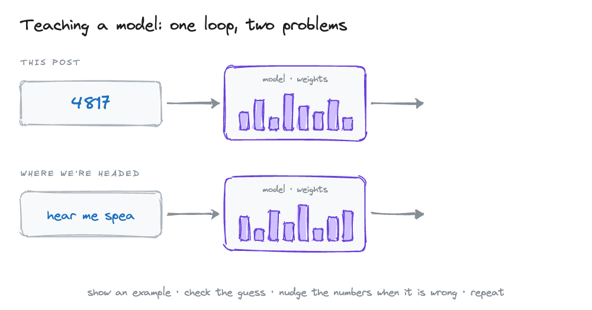
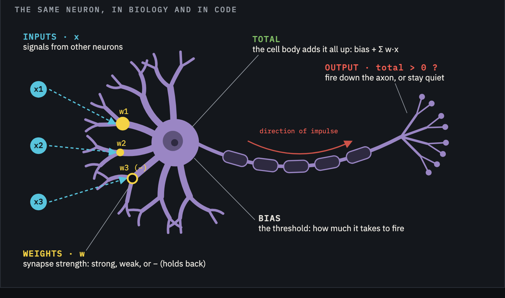
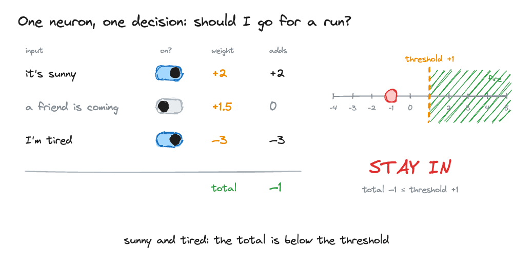
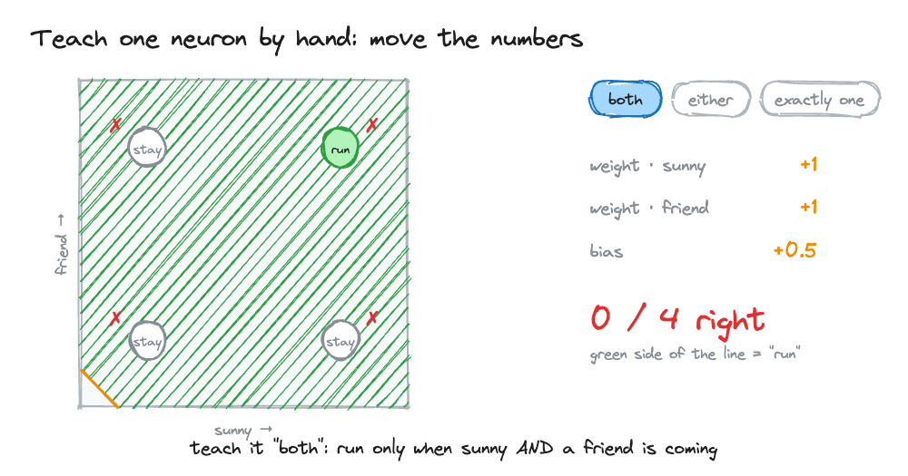
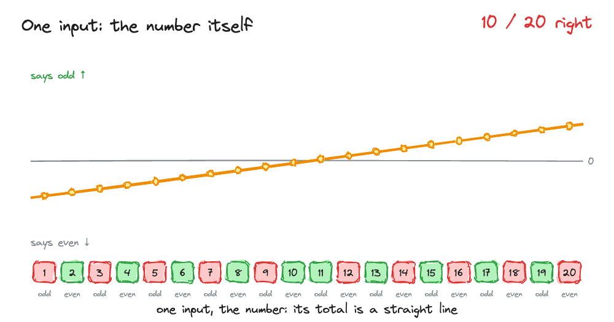
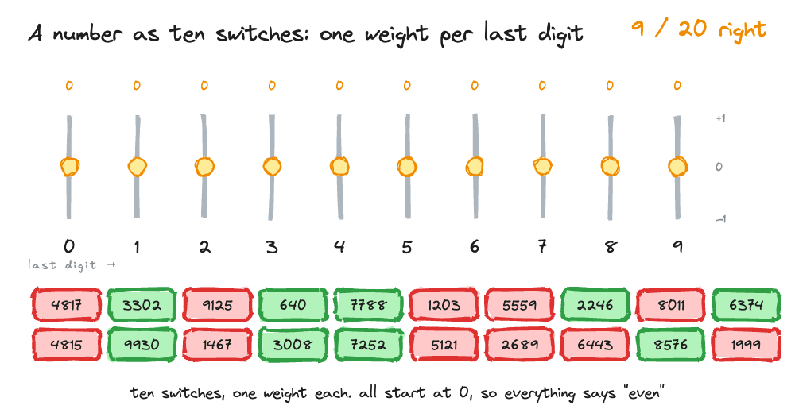
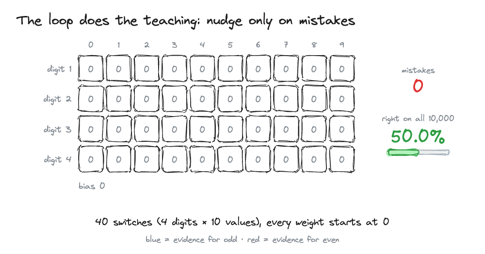

# Let's Build GPT From Scratch (Part 02): How Does a Model Learn?

*Hello again! In Part 01 we built the dumbest model that writes: a 65×65 table, filled in by just counting. And I promised that the next post would throw the counting away and teach that table by **nudging** instead. Then I sat down to write it, and realised I couldn't explain to myself why nudging a pile of numbers should ever turn into knowledge. So this post is a small detour, hehe. A necessary one, I promise :)*

---

## Where are we in this series?

A quick recap of [Part 01](https://mchouhan.co.in/blogs/lets-build-gpt-from-scratch-01/):

- An LLM **predicts the next token**, appends it, and asks again.
- Our model looks at the current character and rolls a die from its row in a **65×65 table**.
- We filled that table by **counting** pairs, and graded it by **how surprised** it is by real text: from 4.17 (random) down to **2.46**.
- Counting doesn't scale. So the next step is to make our system *learn* the probabilities instead.

But what does "learning" actually mean for a piece of software? This is a fundamental question that needs to be answered before we move further on this journey. That is what we will try to answer today.



- **How do I "teach" a model to distinguish even and odd numbers?** ← this post
- **How do I "teach" a model what character should come next?** ← where we're headed: that's what GPT does

The second one is the real goal. But it's the same trick as the first one, just a lot bigger. So let's get the small one right first.

---

To understand what learning even means, we need to look at our brain first.

## Do you know how your brain works?

Scientists and researchers have tried to understand the mechanics of the human brain for thousands of years, and it's still an open-ended problem. :/

But in 1943, two scientists, [Warren McCulloch](https://en.wikipedia.org/wiki/Warren_Sturgis_McCulloch) and [Walter Pitts](https://en.wikipedia.org/wiki/Walter_Pitts), came up with [a mathematical model of one brain cell](https://doi.org/10.1007/BF02478259). That model is the foundation of artificial intelligence today.

See, the human brain works on **[neurons](https://en.wikipedia.org/wiki/Neuron)**. These are extremely complicated cells that emit an (output) signal based on the (input) signals coming into them. *And these signals actually impact everything that we do, every decision we take, everything we ever learned gets recorded or captured in the connections between these cells.*



*Signals come in, each one gets stronger or weaker on the way (the weights), the cell body adds them up, and if the total crosses a threshold, the neuron fires.*

McCulloch and Pitts wrote this down as maths. In code, it's three lines:

```python
def neuron(inputs, weights, bias):
    total = bias + sum(w * x for w, x in zip(weights, inputs))
    return total > 0          # fire, or don't
```

This became the basis of the neuro + mathematical + computing model of artificial intelligence as we know it today.

---

## Where does the logic live?

As software engineers, we're used to giving instructions to a machine. This equation reverses that paradigm.

Look at that function again. Where do you think the logic (the instructions, the information) of the program lives? Think about it for a sec.

Answer: it's all in the **weights and the bias**.

The structure is the same for every neuron that ever existed. But the knowledge lives entirely in its weights and bias. Here's a made-up neuron that decides whether I go for a run:

| input signal       | on? | weight |
| ------------------ | --- | ------ |
| it's sunny         | 1   | +2     |
| a friend is coming | 0   | +1.5   |
| I'm tired          | 1   | −3     |

*total = 2 + 0 − 3 = **−1**, which is below the threshold of 1, so: stay in. With "sunny" and "tired" both on, what's the smallest change that gets me out of the door? Stop being tired, make "sunny" count for more, or drop the threshold: any of them will do. (A friend alone isn't enough: −1 + 1.5 = 0.5, still below 1.)*



### The weights are the program!

*Change the weight, and the decision changes.*

Remember the **parameters** from Part 01, "the adjustable numbers inside the model"? These weights are exactly that. [GPT-3](https://arxiv.org/abs/2005.14165)'s 175 billion parameters are the same kind of number as these three weights.

So then what does **learning** mean?

Answer: it means finding the right weights and bias, so that our software program takes the right decision for a given input :) This is loosely how our brain processes information too.

---

## So how do you teach (or train) a model?

For that, it's important to pause and teach a single neuron *anything* first. And you're going to do it by hand.

Take the run neuron with just two inputs: *sunny* and *friend coming*, each can be either 0 or 1.   
That's only four situations. Pick what you want the neuron to learn, then move the weights until it learns :  


a) go out only if it's sunny and friend is coming  
b) go out if it's sunny OR a friend is coming  
c) go out if either of them is true, BUT not both.



Congratulations! You just taught a neuron two different rules, and the only thing you changed was a few numbers. :P

What about (c), "exactly one"? You can't do it. Put the four situations on the corners of a square, and the border between "fire" and "don't fire" is always a **straight line** across it. A weighted sum can only ever make [one straight cut](https://en.wikipedia.org/wiki/Linear_separability), and "exactly one" needs its two "run" corners on opposite diagonals. Hold on to that, because it's about to bite us.

> **The picture to keep:** teaching a neuron = moving its weights until it gives the right answer. And whatever the weights, a single neuron can only split its inputs with one straight cut.

---

## Now our actual problem: even and odd

How do we teach a neuron the difference between even and odd numbers?

**Attempt 1: give it the number.**  
The obvious design is one input: the number itself. Then the neuron's total is `weight × number + bias`, a straight line. But the answers zig-zag: odd, even, odd, even.



However you tilt and slide it, the best it gets is eleven out of twenty. A straight line crosses the middle *once*. The answers cross it on *every single step*. It's the "exactly one" problem again. Over all 10,000 numbers, the best any line can do is 50%, a coin flip.

The neuron isn't too dumb. It's looking at the problem from an angle where the answer can't be drawn with one cut. So this implies **we need more inputs**.

**Attempt 2: a number as ten switches.**  
Let's try a different approach: represent the number differently. Instead of one input, "the number", give it ten switches, one per possible last digit. Exactly one is on at a time:

```
9 = [0,0,0,0,0,0,0,0,0,1]
2 = [0,0,1,0,0,0,0,0,0,0]
```

Each switch gets its own weight. With just one switch on, the total is simply *that switch's weight* (plus the bias). Now 4817 and 4818 aren't neighbours on a line any more. They use two completely separate weights.



Twenty out of twenty is easy: push the odd digits up and the even digits down. And every number ending in 7 gets the same total, so twenty out of twenty means *all ten thousand* are right. Nothing about the neuron got smarter. Its *inputs* did.

This trick of turning a value into one switch per possibility is called **[one-hot encoding](https://en.wikipedia.org/wiki/One-hot)**. And we've seen it before! Looking up row `t` of our bigram table in Part 01 is exactly this: switch on input `t` out of 65, and read off its weights. GPT does the same with text: one switch per token in its vocabulary.

> **The picture to keep:** how we represent the input is extremely important. One plain number hid the pattern; ten switches made it obvious. The richer the input signals, the more complex the patterns a model can pick up.

---

## How do you teach it without the sliders?

Up to now, *you* were the one doing the teaching. You looked at the wrong answers and moved the sliders. Let's hand that job to a loop.

We show the model each input, and then, based on its response being right or wrong, we nudge it:

1. **Guess.** Add up the weights of the switches that are on, plus the bias. Positive means "odd".
2. **Check** against the right answer.
3. **Right?** Do nothing.
4. **Wrong?** Nudge every weight whose switch was on: +1 if it should have said odd, −1 if it should have said even. Same for the bias.

That's the whole learning rule. [Frank Rosenblatt](https://en.wikipedia.org/wiki/Frank_Rosenblatt) came up with it [in 1958](https://doi.org/10.1037/h0042519) and called the result a **[perceptron](https://en.wikipedia.org/wiki/Perceptron)**.

Let's dry run it, with just the ten last-digit switches. Everything starts at 0:

```
number  total            guess  right?   what moves
17      0                even   ✗ odd    digit 7 → +1, bias → +1
24      1 + 0  =  1      odd    ✗ even   digit 4 → −1, bias →  0
53      0 + 0  =  0      even   ✗ odd    digit 3 → +1, bias → +1
87      1 + 1  =  2      odd    ✓        nothing
38      1 + 0  =  1      odd    ✗ even   digit 8 → −1, bias →  0
```

See what's happening? Every mistake writes the answer into the weight of the digit it saw. A few more mistakes and all ten weights are filled in, and then there's nothing left to fix.

Now let's make it a fair test, and not even tell it which digit matters. It gets all four digits of the number, ten switches each, so **40 switches**. Everything starts at 0.

Before you run it: the rule never mentions the last digit. Which weights do you expect to grow?

```python
weights, bias = [0] * 40, 0
for number, answer in examples:
    switches = switches_for(number)                    # 40 zeros and ones
    total = bias + sum(w * s for w, s in zip(weights, switches))
    guess = 1 if total > 0 else 0
    if guess != answer:
        nudge = +1 if answer == 1 else -1              # which way it was wrong
        for i in range(40):
            weights[i] += nudge * switches[i]          # only switches that were on
        bias += nudge
```

I ran it on 2,000 random numbers. Here's every mistake it made, and every nudge:



The last row turns into stripes, and the other three rows stay at (or near) zero. After a few dozen mistakes it hardly makes any more, so it hardly changes any more.

### And the model has learned `n % 2`.

*Nobody wrote that rule. It's sitting in the bottom row of the grid.*

> **🐇 Rabbit hole: why accuracy here, when Part 01 said accuracy is a bad grade?**
>
> In Part 01, after `"th"` both `e` and `a` are fine answers, so marking the top guess right or wrong threw information away, and we measured *surprise* instead. Odd and even is different: every number has exactly one right answer, and nothing is uncertain. So here, "how often is it right?" is an honest grade. For the next character it isn't, and that's exactly why in the next post we will go back to surprise.

---

## Why does it work? Looks like magic?

Each step of that loop is completely mindless. So where did the understanding come from?

**It learns from hard evidence.** A weight only moves when its switch was on during a mistake: +1 for an odd number, −1 for an even one. So every weight is just a running tally of evidence.

**Signal adds up, noise cancels.** This is the critical one. Our observation that the evenness or oddness of a number depends on the *position* of the digit was crucial. Because every position got its own switches, the model could identify and refine the signal. "Digit 4 is 7" only ever shows up in odd numbers, so every nudge pushes it the same way, and it climbs. "Digit 2 is 8" shows up in odd and even numbers about equally, so its nudges cancel each other out. The same signals got added up, and the noise ended up cancelling itself.

**It only changes on errors.** When the answer is right, the design blocks the nudge. Once the pattern is in the weights, mistakes dry up and the numbers stop moving. It doesn't "know" it's done. It just stops getting corrected.

> **The picture to keep:** learning is a loop that turns every mistake into a tiny edit of the numbers. Only what's consistently linked to the answer survives all those edits, and that's exactly what a pattern is.

> **🐇 Rabbit hole: the line that froze AI for a decade**
>
> Remember "exactly one"? In 1969, [Marvin Minsky](https://en.wikipedia.org/wiki/Marvin_Minsky) and [Seymour Papert](https://en.wikipedia.org/wiki/Seymour_Papert) published a book, [*Perceptrons*](https://en.wikipedia.org/wiki/Perceptrons_(book)), showing exactly that limit: one neuron can't learn it, however long you train. Interest and funding for neural networks [dried up for years](https://en.wikipedia.org/wiki/AI_winter). The way out was to feed neurons into other neurons, which is where this series is going.

---

## The same thing, in a programmer's world!!

| | programming | machine learning |
| --- | --- | --- |
| **you write** | the rules | the pipeline (a model + a nudge rule) |
| **you give** | the input | inputs AND answers |
| **you get** | an answer | the rules, as weights |

You haven't stopped giving the machine instructions. You've moved up one level. Instead of "here's how to tell odd from even", the instruction is "here's how to get less wrong". And the part that's still very much your job is the data and the inputs. Remember, the whole thing only worked because we picked the right switches.

---

## Play with it

Everything above is in one file, [`playground.py`](https://github.com/m-chouhan/experiments-with-ai/blob/main/experiments/003-teaching-a-net-tic-tac-toe/playground.py). No libraries, just `python3 playground.py`. The knobs are at the top:

- Set `INPUTS = 'number'` and watch it get stuck at 50%. Then try `'last digit'`, then `'all digits'`.
- Swap the `rule` for "divisible by 3" and watch one neuron fail. (Why? "Exactly one" again.)
- Change `EXAMPLES` and `SEED` and see how few examples it really needs.

---

## Wrapping up

No new row on the scoreboard this time. It's a detour, after all :P But in this post we found out:

- **A neuron is a weighted sum and a threshold.** Three lines of code, borrowed from biology in 1943.
- **The weights are the program.** Learning means finding the right weights.
- **The inputs decide what's learnable.** One straight cut can't split odd from even, but one-hot switches make it easy.
- **A dumb loop can find the weights.** Guess, check, and nudge on every mistake. Signal adds up, noise cancels, and it stops when the mistakes stop.

**Next post:** *Same score, new engine*, for real this time. Our bigram table from Part 01 is just 65 neurons, each with 65 one-hot inputs. We start it from zeros and nudge it. The difference: it can't wait for a clear "wrong", because the next character is never certain. So it nudges on *every* example, by *how surprised* it was. That's [gradient descent](https://en.wikipedia.org/wiki/Gradient_descent), and it's what eventually trains a GPT.

If something here didn't click, or you know a better way to explain it, tell me in the comments. I'm learning this too :)

### Further reading

1. [3Blue1Brown, *Neural Networks*](https://www.3blue1brown.com/topics/neural-networks). The videos that inspired this post.
2. [Michael Nielsen, *Neural Networks and Deep Learning*, chapter 1](http://neuralnetworksanddeeplearning.com/chap1.html). Perceptrons, then sigmoid neurons. The same path as this post.
3. [Wikipedia, *Perceptron*](https://en.wikipedia.org/wiki/Perceptron). The history, including Rosenblatt and the Minsky–Papert book.
4. [Andrej Karpathy, *The spelled-out intro to neural networks and backpropagation*](https://www.youtube.com/watch?v=VMj-3S1tku0). The step after this one.

---

*Code for this post:* [github.com/m-chouhan/experiments-with-ai](https://github.com/m-chouhan/experiments-with-ai/tree/main/experiments/003-teaching-a-net-tic-tac-toe)
